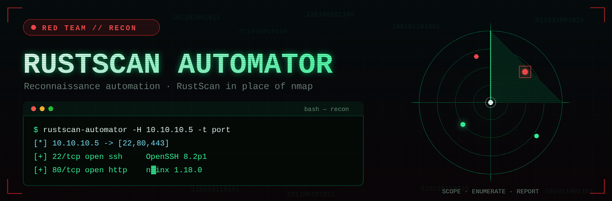

# RustScan Automator

<p align="center">
  
</p>

<p align="center">
  <a href="https://github.com/orionhack99/rustscan-automator/actions/workflows/ci.yml"></a>
  <a href="https://github.com/orionhack99/rustscan-automator/releases/latest"></a>
  <a href="LICENSE"></a>
  
</p>

Reconnaissance automation that orchestrates [RustScan](https://github.com/RustScan/RustScan)
in place of nmap. It is modeled on the reconnaissance workflows of
[nmapAutomator](https://github.com/21y4d/nmapAutomator) but deliberately limits
itself to reconnaissance: exploitation and third-party enumeration tools
(nikto, dirb, gobuster, wfuzz, metasploit, and friends) are **out of scope** and
are blocked by a recon-only nmap allowlist.

## Scan modes

| `--type`          | What it does                                                                 |
| ----------------- | ---------------------------------------------------------------------------- |
| `port`            | Full-range TCP port discovery via RustScan greppable output.                 |
| `network`         | Live-host discovery over a bounded set of common ports (no ICMP ping mode).  |
| `service`         | Service/version recon using RustScan's nmap handoff (`-sV -sC`).             |
| `vuln`            | Recon-only vulnerability scripts via nmap's `vuln` category.                 |
| `udp`             | UDP port discovery (requires elevated privileges).                           |
| `full` / `all`    | Full-range sweep, then service and vulnerability reconnaissance.             |
| `recon`           | Built-in next-step guidance derived from a quick scan (no external tools).   |

## Usage

```sh
cargo build --release

# Full-range port discovery
./target/release/rustscan-automator -H 10.0.0.5 -t port

# Service/version recon on selected ports
./target/release/rustscan-automator -H scanme.example.com -t service --ports 22,80,443

# Comprehensive workflow into a custom output directory
./target/release/rustscan-automator -H 10.0.0.0/24 -t full -o ./results

# UDP discovery (needs sudo because RustScan requires raw sockets)
sudo ./target/release/rustscan-automator -H 10.0.0.5 -t udp --ports 53,123
```

Run `rustscan-automator --help` for the full option list.

## Output

Everything is written under `<output-dir>/<target-label>/`:

- `<target>_<mode>_<timestamp>.txt` and `.json` — per-mode findings.
- `<target>_summary_<timestamp>.txt` and `.json` — consolidated `RunSummary`.
- `<target>_session_<timestamp>.log` — a tee of the console session.

Existing files are never overwritten; colliding names get a `-1`, `-2`, ...
suffix.

## Exit codes

| Code | Meaning                |
| ---- | ---------------------- |
| 0    | Success                |
| 1    | Runtime failure        |
| 2    | Invalid input          |
| 3    | Missing dependency     |
| 4    | Privilege required     |

## Development

```sh
cargo test            # hermetic: never touches a live network
cargo clippy --all-targets
```

Tests inject a fake `CommandRunner`, so the suite replays canned RustScan output
instead of spawning real scans.

## CI/CD

Continuous integration and releases run on GitHub Actions (`.github/workflows/`):

- **CI** ([`ci.yml`](.github/workflows/ci.yml)) — on every push to `main` and on
  pull requests: `cargo fmt --check`, `cargo clippy -- -D warnings`, and the full
  test suite plus a release build on **Linux** and **macOS**. A non-blocking
  `cargo-audit` job reports dependency advisories.
- **Release** ([`release.yml`](.github/workflows/release.yml)) — triggered by a
  `v*` tag (or manually). Builds and attaches binaries with SHA-256 checksums for
  `x86_64-unknown-linux-gnu`, `x86_64-unknown-linux-musl` (static),
  `x86_64-apple-darwin`, and `aarch64-apple-darwin` to the GitHub Release.

Dependabot keeps Cargo dependencies and action versions current.

### Cutting a release

```sh
# bump the version in Cargo.toml, then:
git tag v0.1.0
git push origin v0.1.0
```

The tag triggers the release workflow and publishes the binaries.

## Documentation

Full step-by-step usage instructions: [`docs/USAGE.md`](docs/USAGE.md).

## Licença

Distribuído sob a licença **MIT**. Veja [`LICENSE`](LICENSE).

## Ética e uso legal

Use somente em alvos para os quais você tem autorização explícita. Alvos
públicos de teste: `scanme.nmap.org`, `scanme.sh`.

